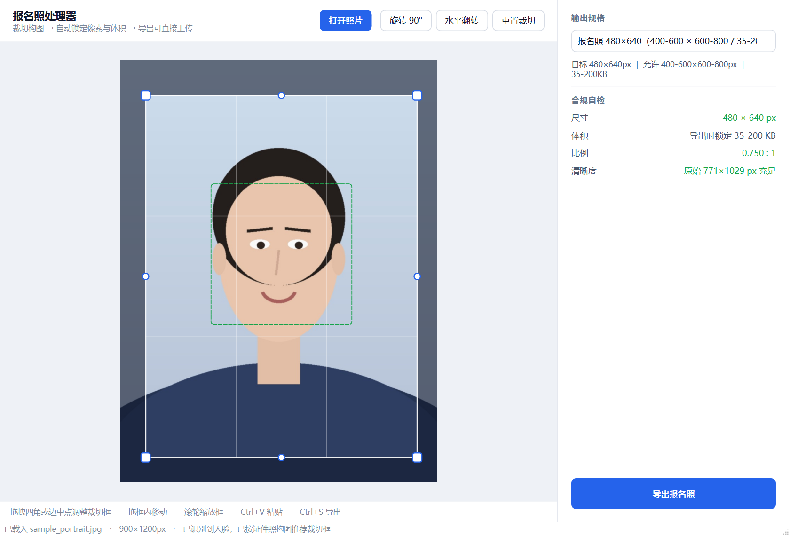

# 京考报名照处理器 · GWY Photo Tool

一个**离线、绿色、双击即用**的 Windows 证件照处理器：把手机里随便一张照片，裁切成符合报名要求的证件照，并自动把**像素尺寸**和**文件体积**锁进规定区间。

为公务员考试（国考 / 京考 / 省考）等网上报名场景设计，也可用于任何要求"指定像素 + 指定体积"的证件照上传。



---

## 为什么不用官方「照片处理工具」？

官方工具（`gwyzpclgj.zip` 里的 `照片处理工具.exe`）是 2014 年编译的 32 位 MFC 程序，依赖 2006 年的 OpenCV 1.0 运行库。它的说明书原文是：

> 照片宽度不低于 295 像素，高度不低于 413 像素……保存后的照片大小在 10K 左右。

也就是说它只做**合规校验 + 原样重存**，能力边界很清楚：

| | 官方照片处理工具 | 本项目 |
|---|---|---|
| 裁切构图 | ❌ 不能，只能整张接受或拒绝 | ✅ 固定比例裁切框，手动精调 |
| 指定输出像素 | ❌ 只校验下限 | ✅ 目标尺寸 + 区间强校验 |
| 指定文件体积区间 | ❌ 固定约 10KB | ✅ 35-200KB 任意区间自动收敛 |
| 人脸辅助构图 | ❌ 无 | ✅ 本地检测，自动给推荐框 |
| 新系统兼容 | ⚠️ 高 DPI 下界面错位（说明书自己教用户改缩放） | ✅ Qt6，自动适配 125%/150% |
| 安装依赖 | 8 个 DLL，解压后必须同目录运行 | ✅ 单文件 exe，可随便挪 |

---

## 默认输出规格

| 指标 | 要求 | 实现 |
|---|---|---|
| 宽度 | 400 – 600 px | 目标 480px，导出前断言 |
| 高度 | 600 – 800 px | 目标 640px（3:4），导出前断言 |
| 体积 | 35 – 200 KB | JPEG 质量搜索，落在 60-120KB 舒适区 |
| 格式 | JPG / JPEG | sRGB、300DPI、自动剥离 EXIF 隐私信息 |

界面里可一键切换到「国考（≥295×413 / 10-200KB）」「一寸 295×413」「二寸 413×579」等档位，参数全部可见可改。

---

## 功能

- **拖进来就能用**：拖拽、按钮选择、`Ctrl+V` 粘贴三种导入方式，自动按 EXIF 纠正手机竖拍方向。
- **裁切框比例锁定**：拖四角/四边改大小、拖框内移动、滚轮缩放，框外实时压暗，带三分构图线。
- **人脸辅助构图**：本地 Haar 级联检测，按"头顶留白 8%、眼睛在画面 40%、头高约占 63%"生成推荐框；检测不到就退化为居中框，不会卡流程。
- **体积与像素双约束**：质量因子 95→50 搜索，体积贴近下限时自动换更大的合法尺寸补足；纯色图细节太少时做微观纹理补偿（肉眼不可见）。
- **合规自检面板**：尺寸 / 体积 / 比例 / 清晰度四项逐条红绿提示，像素不足会明确警告"会放大"。
- **纯本地**：无网络请求、无账号、无上传，照片不出本机。

---

## 使用

### 方式一：直接运行 exe

1. 从 [Releases](../../releases) 下载 `报名照处理器.exe`；
2. 双击打开（首次启动会自解压，约 2-4 秒）；
3. 拖入照片 → 调整裁切框 → 点「导出报名照」；
4. 默认保存为 `报名照片.jpg`。

> 若 Windows SmartScreen 提示未知发布者，点「更多信息 → 仍要运行」。这是未做代码签名的开源程序的正常现象，源码全部在本仓库，可自行校验或自行编译。

### 方式二：从源码运行

```bash
pip install -r requirements.txt
python src/app.py
```

### 方式三：自己打包 exe

```bash
python build/build_exe.py            # 单文件版 → dist/报名照处理器.exe
python build/build_exe.py --onedir   # 目录版（被杀软误报时用这个）
```

---

## 快捷键

| 快捷键 | 功能 |
|---|---|
| `Ctrl+O` | 打开照片 |
| `Ctrl+V` | 粘贴剪贴板图片 |
| `Ctrl+S` | 导出 |
| 拖拽 | 移动 / 缩放裁切框 |
| 滚轮 | 以光标为中心缩放裁切框 |

---

## 项目结构

```
gwy-photo-tool/
├─ src/
│  ├─ app.py                     # 入口（含隐藏的 --selftest / --smoke 自检参数）
│  └─ photo_tool/
│     ├─ core/
│     │  ├─ presets.py           # 规格档位与硬性校验
│     │  ├─ processor.py         # 裁切、缩放、体积-像素双约束编码
│     │  ├─ detector.py          # 人脸检测与证件照构图建议
│     │  └─ resources.py         # 资源路径（兼容 PyInstaller）
│     ├─ ui/
│     │  ├─ crop_canvas.py       # 裁切画布（自绘交互）
│     │  └─ main_window.py       # 主窗口与合规面板
│     └─ assets/                 # 图标 + Haar 人脸模型
├─ build/
│  ├─ build_exe.py               # 一键打包
│  └─ make_icon.py               # 代码生成图标
├─ tests/test_processor.py       # 核心算法单测
└─ .github/workflows/build.yml   # 打 tag 自动构建并发布
```

## 开发与测试

```bash
python -m unittest discover -s tests -v     # 单元测试
python src/app.py --selftest                # 无界面跑一遍核心算法，生成 selftest_report.txt
```

发布新版本：

```bash
git tag v1.0.0 && git push origin v1.0.0
```

GitHub Actions 会自动在 `windows-latest` 上打包并把 exe 挂到 Release。

---

## 常见问题

**Q：导出的照片能直接上传吗？**
能。工具只保证"像素尺寸 + 体积 + JPG 格式"这三项机器可读的硬指标。背景颜色、是否免冠、是否近期照等主观要求仍需自行把关；最终以报名网站校验结果为准。

**Q：会不会把我的照片传出去？**
不会。程序不含任何联网代码，可断网使用，也可以自己看源码验证。

**Q：为什么不做一键美颜 / AI 换背景？**
官方明确要求"照片不得美化、修饰"，美化过度反而可能被判不合格。本工具刻意只做几何裁切与编码控制。

**Q：exe 有 80MB？**
PySide6（Qt6）本身就有几十 MB。换来的是不依赖任何运行库、双击即用。若要更小体积可自行改 `build/build_exe.py` 的排除项，或用 `--onedir` 版。

---

## 免责声明

本项目为个人开源工具，**与任何官方机构无关**，不保证通过报名网站审核。照片真实性、合规性由使用者本人负责。请以当年官方公告与报名网站的要求为最终依据。

## License

[MIT](LICENSE)
